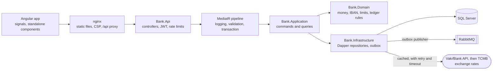
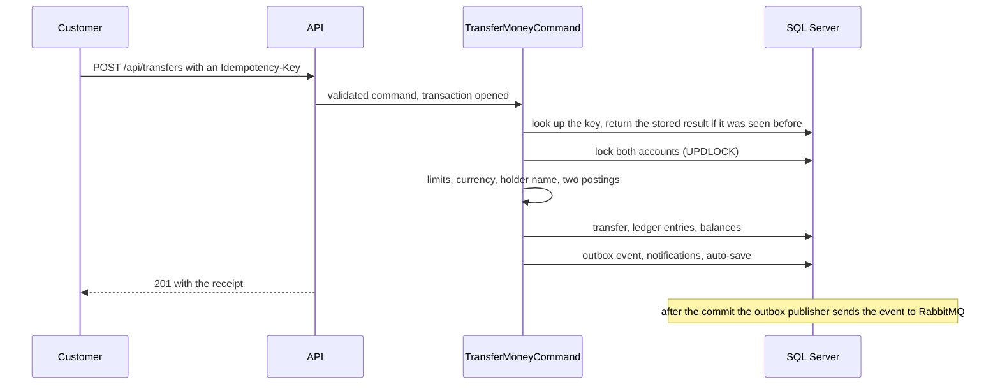

# FinGen

A retail bank with a personal finance planner built in. Customers hold accounts and cards, send money by IBAN and save towards
goals; the planner shows the months ahead day by day, so a short month is visible before it arrives. A portfolio project, not a
live service.

The planner only shows the customer's own obligations. It never recommends a product or a decision.

## What it does

Banking
- Accounts in TRY, USD and EUR with generated IBANs, statements read from a double-entry ledger, closing an empty account.
- Transfers by IBAN with a review step and a receipt. Each transfer carries an Idempotency-Key, so a retry never sends the money
  twice.
- Debit and credit cards: contactless and online use, daily and monthly limits, a temporary block.
- Splitting an expense with friends. A friend who banks here is asked in the app and pays their share with a transfer;
  a friend outside is marked paid by hand.

Savings
- Goals with their own savings account. Money goes in and out through the ledger like any other transfer.
- Auto-save: when at least a set amount arrives on an account (a salary), a percentage or a fixed amount moves to the goal in the
  same transaction.
- A wish list per year: what is wanted in the customer's own words (the model, the colour, where to), over how many years,
  and a photo if they like. Each wish is a goal with its own savings account.

Planning and insight
- Cash-flow projection from known income, expenses, subscriptions, card statements and installments.
- Installment scenarios compared side by side before a purchase.
- Statement import from other banks and analytics on the history: category trends, recurring payments, unusual spending.
- Exchange rates from VakıfBank's API Portal when its credentials are set, with TCMB's public daily rates behind it,
  a converter, and foreign currency balances estimated in lira.

Customer
- Profile, contact details, password change, two-step verification with an authenticator app, data export and account
  erasure under KVKK.
- A notification centre: money sent or received, auto-saves, goals reached, split requests and answers, every
  sign-in, a lock, a new password, two-step verification switched on or off, a blocked card.
- Light, dark or system theme and an accent colour, saved with the account.
- A young mode for customers just starting out: a colour of its own, rounder shapes, a plainer first-name voice and
  a home screen that leads with savings and wishes.

## Banking rules

| Area | Rule |
|---|---|
| Transfers | Same currency only. The recipient's name must match the IBAN holder. The sender's balance must cover the amount. |
| Limits | Money sent to other customers is capped per transfer and per business day, per currency (TRY 250,000 and 750,000 by default). Moves between a customer's own accounts and goals are not limited. |
| Accounts | A frozen or closed account neither sends nor receives. At most 5 open accounts per currency. Only an empty account closes, and the last lira demand account stays open. |
| Savings | A goal's savings account only moves money to the owner's own accounts. A goal closes once its savings account is empty. Auto-save never goes past the target and never blocks the payment that triggered it. |
| Cards | The daily limit cannot exceed the monthly limit. A temporary block can be lifted; cancellation is final, and a cancelled card can no longer be changed. |
| Customers | The T.C. identity number is checked with its check digits. Phone numbers must be Turkish mobile numbers. Passwords need 12 characters with a letter and a digit, and must not be known from a data breach. Five wrong passwords or codes in a row lock the account for 15 minutes. |
| Splits | Shares cannot add up to more than the expense. A friend's name must match the IBAN holder. A share is settled only by the friend's own transfer to the payer's account for exactly the share, and one transfer settles one share. |
| Notifications | Written in the same transaction as the change, so a refused transfer leaves none. Moves between a customer's own accounts are not announced. Read ones are removed after 90 days, unread ones stay. |
| Ledger | Every transfer is two postings that balance. Balances never go negative, enforced by the database as a last line of defence. |

Limits are read from the `Banking` section of `appsettings.json`. The reasoning is in [ADR-0013](docs/adr/0013-banking-rules.md).

## Security

Short-lived access tokens kept in memory, rotating refresh cookies with reuse detection, an optional second factor
(authenticator app codes, the key stored encrypted), account lockout after repeated wrong passwords, new passwords
checked against known breaches without the password leaving the server, rate limits on sign-in and on money movements,
a strict Content-Security-Policy with a per-request nonce for styles, and secret scanning, CodeQL and Dependabot in CI.
The threat model and the OWASP ASVS review are in [SECURITY.md](SECURITY.md).

## Stack

.NET 10, ASP.NET Core, MediatR, FluentValidation, Dapper, SQL Server (DbUp migrations), RabbitMQ, Serilog, Angular 21,
Tailwind, ECharts. xUnit, Vitest and Playwright for tests, GitHub Actions for CI.

## Architecture



The backend follows Clean Architecture. Dependencies point inwards: `Bank.Domain` knows nothing else, `Bank.Application`
knows the domain and declares the interfaces it needs (repositories, current user, clock), `Bank.Infrastructure` implements
them, and `Bank.Api` wires everything together. `Bank.Contracts` holds the request, response and event shapes, so the API
surface can be read in one place.

Every request goes through MediatR as a command or a query. Three behaviours wrap each handler:

1. Logging, with the correlation id of the request.
2. Validation with FluentValidation. A failure becomes a 400 before the handler runs.
3. A transaction for commands that move money or change several tables. The handler, the ledger postings, the outbox event
   and the notifications commit together or not at all.

A transfer, as an example of how the pieces meet:



The frontend is split into layers that may only import downwards, checked in CI by `scripts/check-layers.mjs`:

| Layer | Holds | May use |
|---|---|---|
| core | session, HTTP interceptors, theme, base page | nothing else |
| data-access | API clients and models | core |
| shared | UI pieces, money display, stores | core, data-access |
| features | one folder per screen | core, data-access, shared |
| layout | the signed-in frame and the sign-in frame | core, data-access, shared |

Pages own the loading and saving state. The components below them only show and collect. The access token stays in memory,
the refresh token in an HttpOnly cookie.

## Database

SQL Server, changed only through numbered DbUp scripts in `backend/src/Bank.Database/Migrations`. In development the API applies
them on start; anywhere else it refuses to start on a database that is behind the build. Tables are grouped by schema:

| Schema | Tables | What for |
|---|---|---|
| dbo | Users, Accounts, Cards, Transactions, RefreshTokens, UserSecurity, UserPreferences, Notifications | the customer, accounts and cards, sessions, sign-in protection |
| payments | Transfers, LedgerEntries | money movement, double-entry |
| savings | Goals, AutoSaveRuns, GoalPhotos | goals and wishes with their own savings account, and their photos |
| finance | CreditCards, RecurringCashFlows, InstallmentPlans, ImportBatches, Transactions | the planner's inputs; cards, plans and cash flows are system-versioned |
| messaging | OutboxMessages | events waiting to be published |
| splits | Splits, Shares | expenses split with friends and who owes what |
| compliance | ErasedIdentities | who was erased under KVKK, and when |

```mermaid
erDiagram
    Users ||--o{ Accounts : holds
    Users ||--o{ Cards : holds
    Accounts ||--o{ Cards : "card of"
    Users ||--o{ Transfers : sends
    Accounts ||--o{ Transfers : "source or target"
    Transfers ||--|{ LedgerEntries : "posted as"
    Accounts ||--o{ LedgerEntries : "posted to"
    Accounts ||--o{ Transactions : statement
    Users ||--o{ Goals : saves
    Accounts ||--o| Goals : "savings account of"
    Goals ||--o{ AutoSaveRuns : "fed by"
    Transfers ||--o{ AutoSaveRuns : triggers
    Goals ||--o| GoalPhotos : "pictured by"
    Users ||--o{ RefreshTokens : "signed in with"
    Users ||--o| UserSecurity : "guarded by"
    Users ||--o| UserPreferences : prefers
    Users ||--o{ Notifications : "is told"
    Users ||--o{ CreditCards : plans
    CreditCards ||--o{ InstallmentPlans : "paid with"
    CreditCards ||--o{ RecurringCashFlows : "charged to"
    Users ||--o{ ImportBatches : imports
    ImportBatches ||--o{ HistoryTransactions : contains
    Users ||--o| ErasedIdentities : "erased as"
    Users ||--o{ Splits : "paid and split"
    Splits ||--|{ Shares : "asks for"
    Users ||--o{ Shares : owes
    Transfers ||--o| Shares : settles
    Accounts ||--o{ Splits : "receives for"

    Users {
        bigint UserId PK
        char TcNo UK
        nvarchar FirstName
        nvarchar LastName
        nvarchar Email UK
        varchar PasswordHash
    }
    Accounts {
        bigint AccountId PK
        bigint UserId FK
        varchar AccountType "Demand, Time, ForeignCurrency, Savings"
        char CurrencyCode
        char Iban UK
        decimal Balance "never below zero"
        varchar Status
    }
    Cards {
        bigint CardId PK
        bigint AccountId FK
        char CardLastFour
        varchar Status
        decimal DailyLimit
        decimal MonthlyLimit
    }
    Transfers {
        bigint TransferId PK
        bigint UserId FK
        varchar IdempotencyKey "unique per user"
        binary RequestHash
        bigint SourceAccountId FK
        bigint TargetAccountId FK
        decimal Amount
    }
    LedgerEntries {
        bigint EntryId PK
        bigint TransferId FK
        bigint AccountId FK
        varchar Side "one debit and one credit"
        decimal Amount
        decimal BalanceAfter
    }
    Transactions {
        bigint TransactionId PK
        bigint AccountId FK
        decimal Amount
        varchar Direction
    }
    Goals {
        bigint GoalId PK
        bigint UserId FK
        bigint AccountId FK "own savings account"
        decimal TargetAmount
        smallint NewYearOf
        bigint AutoSaveSourceAccountId FK
    }
    GoalPhotos {
        bigint GoalId PK
        varchar ContentType "jpeg, png or webp"
        varbinary Content "at most 2 MB"
    }
    AutoSaveRuns {
        bigint GoalId PK
        bigint TriggerTransferId PK
        bigint TransferId FK
    }
    RefreshTokens {
        bigint TokenId PK
        binary TokenHash UK
        datetime ExpiresAt
        bigint ReplacedByTokenId FK
    }
    UserSecurity {
        bigint UserId PK
        int FailedSignIns
        datetime LockedUntil
        varbinary TotpSecret "encrypted by the API"
        bigint TotpLastStep "a code works once"
    }
    UserPreferences {
        bigint UserId PK
        varchar Theme
        varchar Accent
    }
    Notifications {
        bigint NotificationId PK
        bigint UserId FK
        varchar Kind
        nvarchar Title
        datetime ReadAt
    }
    CreditCards {
        bigint CreditCardId PK
        bigint UserId FK
        decimal LimitAmount
        tinyint StatementDay
    }
    InstallmentPlans {
        bigint InstallmentPlanId PK
        bigint CreditCardId FK
        decimal TotalAmount
        tinyint InstallmentCount
    }
    RecurringCashFlows {
        bigint RecurringCashFlowId PK
        bigint CreditCardId FK
        varchar Kind
        decimal Amount
        varchar Frequency
    }
    ImportBatches {
        uniqueidentifier ImportBatchId PK
        bigint UserId FK
        varchar Source
    }
    HistoryTransactions {
        bigint TransactionId PK
        uniqueidentifier ImportBatchId FK
        binary Fingerprint "duplicate check"
        decimal Amount
    }
    Splits {
        bigint SplitId PK
        bigint OwnerUserId FK
        bigint ReceivingAccountId FK
        nvarchar Title
        decimal TotalAmount
        date SpentOn
    }
    Shares {
        bigint ShareId PK
        bigint SplitId FK
        bigint DebtorUserId FK "null for a friend outside the bank"
        decimal Amount
        varchar Status
        bigint TransferId FK "unique, settles the share"
    }
    ErasedIdentities {
        bigint UserId PK
        char TcNo
        datetime ErasedAt
    }
```



`HistoryTransactions` is `finance.Transactions`, the history imported from other banks. `Transactions` is the bank's own
account statement in `dbo`. `messaging.OutboxMessages` has no foreign keys on purpose, because events carry ids and amounts
only.

Some choices worth knowing:

- Money is never floating point. Balances and ledger amounts are `DECIMAL(19,4)`; goal and split amounts, always whole
  kuruş, are `DECIMAL(19,2)`. A check constraint keeps balances from going negative even if the code had a bug, and a
  transfer is always exactly one debit and one credit (`UQ_LedgerEntries_TransferSide`).
- The idempotency key is unique per customer, so a retried transfer finds the first one instead of sending money twice.
- The planner's tables are temporal (system-versioned), so every change to a card or a plan keeps its earlier version.
- Erasure is one stored procedure, `compliance.EraseUser`. It deletes the person's own data with its history, closes the
  accounts and anonymises the user row. The ledger stays, because the other side of each transfer still needs it.

## Known limits

What a bank going live would still need, marked in the code with "Known limit:" where it applies:

- A second factor on every sign-in, as BDDK expects for internet banking. Today it is optional and an authenticator app
  code; an SMS code needs an SMS provider.
- Rate limit counters shared between API instances; each instance counts on its own.
- Card payments. Card limits and switches are stored and checked, but no authorisation flow uses them yet.
- A consumer for the published events, and an asymmetric signing key once other services need to check tokens.
- Archiving the ledger after its ten-year retention. Every other record has a retention period and is removed when it
  runs out (ADR-0005).

## Layout

```
backend/src/
  Bank.Domain/          business rules: accounts, transfers, limits, cards, projection, scenarios
  Bank.Application/     commands and queries (Features/), pipeline behaviours
  Bank.Infrastructure/  repositories, outbox, RabbitMQ, market data, security
  Bank.Api/             controllers, middleware, rate limits
  Bank.Contracts/       DTOs and events
  Bank.Database/        DbUp migrator and SQL scripts
backend/tests/          unit and integration tests
backend/tools/          Bank.Evaluation: reproduces the analytics evaluation
frontend/               Angular app; design tokens in projects/bank-app/src/design
frontend/e2e/           Playwright end-to-end tests
frontend/scripts/       the layer check run in CI
docs/                   decisions (adr/), notes, analytics evaluation
```

## Run

With Docker:

```bash
cp .env.example .env    # fill in the secrets
docker compose up --build
```

The web app is on http://localhost:8080.

Without Docker you need the .NET 10 SDK, Node 22 and a local SQL Server:

```bash
cd backend
dotnet run --project src/Bank.Database      # creates BankDb and applies the migrations

cd src/Bank.Api
dotnet user-secrets set "Jwt:Key" "<at least 32 random characters>"
dotnet user-secrets set "Security:EncryptionKey" "<another 32+ random characters>"
# optional: rates from VakıfBank's sandbox in front of TCMB
dotnet user-secrets set "MarketData:VakifBank:ClientId" "<client id>"
dotnet user-secrets set "MarketData:VakifBank:ClientSecret" "<client secret>"
dotnet run                                  # http://localhost:5164

cd ../../../frontend
npm install
npm start                                   # http://localhost:4200
```

After signing up, İşlem geçmişi > 12 aylık demo verisi oluştur fills the account with sample data.

## Test

```bash
cd backend && dotnet test                   # integration tests need SQL Server
cd frontend && npx ng test --watch=false
cd frontend && npm run e2e                  # Playwright, against the API on :5164
```

Integration tests run against a real database, `BankDb_IntegrationTests`, rebuilt from the migrations on every run. Set
`INTEGRATION_TESTS_DB` to use another server. The RabbitMQ test only runs when `RABBITMQ_HOST` is set. Outside services, TCMB's
rates and the breached password list, are replaced by fakes, so the suite never needs the internet.

The end-to-end tests in `frontend/e2e` sign up their own customers and walk through accounts, transfers, planning, goals
and the wish list with a photo, splitting an expense between two customers, notifications, the young mode, two-step
verification, the profile and erasure in a real browser. CI runs them against a fresh database, and also starts the whole
system with `docker compose` and checks it through nginx, including the style nonce.

## Docs

- [Decisions](docs/adr/)
- [Security](SECURITY.md)
- [Notes](docs/ENGINEERING_LOG.md): problems that took a while to solve
- [TODO](docs/TODO.md)
- [Analytics evaluation](docs/analytics/EVALUATION.md)
